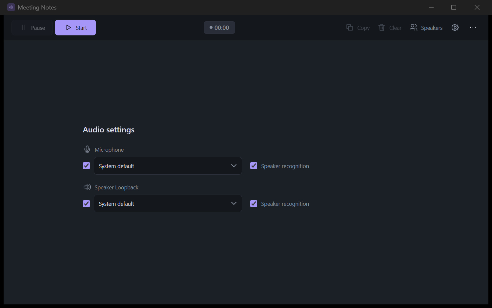
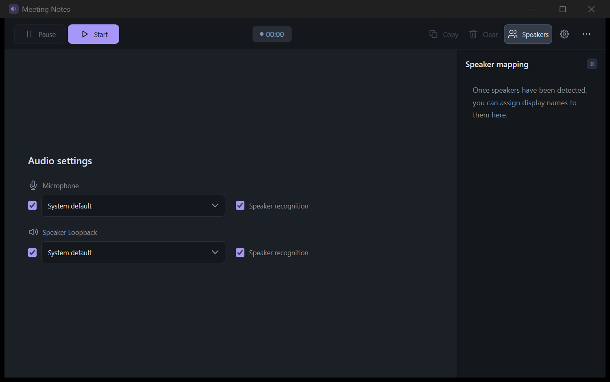
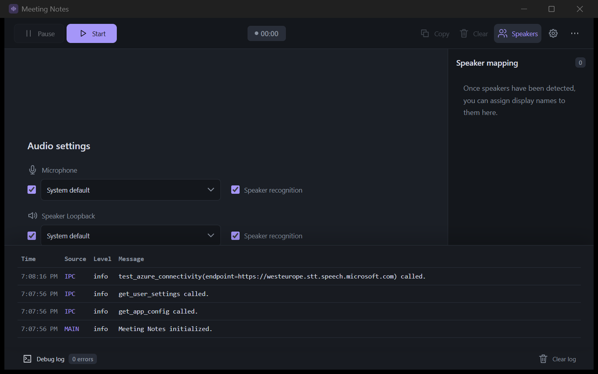
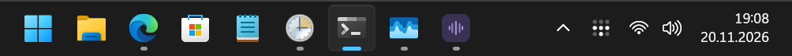

# 🎙️ Meeting Notes

**Live meeting transcripts for Windows — capture your microphone and system audio, identify speakers, and export readable Markdown notes.**

Meeting Notes uses Azure Speech to turn conversations into text as they happen.
It can transcribe your own voice and the audio playing on your computer at the
same time, making it useful for video calls. Either audio source can also be
used on its own.

[⬇️ Download](https://github.com/schirkan/meeting-notes-tauri/releases) ·
[🐛 Report an issue](https://github.com/schirkan/meeting-notes-tauri/issues) ·
[📄 License](./LICENSE)

## ✨ Features

- **Live transcripts:** See interim text during the conversation and finalized results as recognition completes.
- **Independent audio sources:** Choose a microphone, speaker playback (loopback), or both.
- **Speaker mapping:** Enable speaker recognition separately for each source and replace speaker labels with names.
- **Pause and resume:** Pause transcription and continue within the same session.
- **Markdown export:** Save or copy finalized transcripts with timestamps, speakers, and session metadata.
- **Portable app:** Extract the complete folder and run it without an installer. The .NET runtime ships with the app.
- **Connection diagnostics:** Test Azure connectivity and an optional corporate proxy from the settings dialog.
- **Application information and diagnostics:** **About** in the three-dot menu shows the app icon, repository, author and MIT license. **Dev-Tools (F12)** toggles developer tools, as does F12. Webpage right-click menus are suppressed except in text fields and editable content; native window and tray menus are unaffected.
- **System tray:** The tray icon turns **red while recording**, **yellow while paused**, and returns to its original color after stopping or a sidecar crash. Right-click it for **Show** or **Quit**. **Show** and a left double-click restore and focus the main window. **Minimize to system tray on close** under **General** keeps the app, recording and meeting detection running when closing the window. Enabled by default from **v0.1.2**; **Quit** always exits. The preference applies after saving, without restarting.
- **Automatic recording:** "Start recording automatically when a meeting is detected" is enabled by default from **v0.1.2** and the app watches the Windows audio session graph in the background. An active audio session from an allowed meeting application starts recording. When all of that process's microphone/output sessions remain inactive for 3 seconds, its automatically started recording stops via the normal stop/export path. Manual recordings are never stopped by the detector. Automatic start and matching session-end stop share the same enabled setting. This is an audio-session heuristic, not a definitive meeting signal; real Teams/Zoom acceptance remains open.

## Screenshots

The images below are **captures of the real application**: the built `MeetingNotes.exe`
runs in the interactive Windows session and the real window is recorded with
`PrintWindow(PW_RENDERFULLCONTENT)`. They therefore show the native window frame, the
real app icon, the real WebView2 content and the real Windows taskbar with the tray
icon. The one exception is the live transcript: a real recording needs Azure Speech
credentials, so that view comes from the headless renderer (`npm run screenshots`).
See [docs/README.md](./docs/README.md) for the details of both sets.

### Main window



### Live transcript


### Settings

The dialog is one compact scrolling page with the sections **General**,
**Transcription**, **Azure** and **Proxy**. Audio controls live on the start page,
so two captures - from the top and from the bottom - show the whole dialog.

| Settings (top) | Settings (bottom) |
|---|---|
|  |  |

### About


### Connection diagnostics


### Speaker mapping



### Debug log



### Taskbar



The notification-area icon, context menu, double-click and closing with X under
both close-to-tray settings were manually confirmed on 2026-11-19. Alt+F4 and
exiting during a recording remain untested; see [T-514](./specs/T-514-systray-und-schliessen-verhalten.md).

## 📦 Installation

### Requirements

- Windows 11, 64-bit (x64)
- [Microsoft Edge WebView2 Runtime](https://developer.microsoft.com/en-us/microsoft-edge/webview2/) — already installed on many Windows 11 systems
- An internet connection and an **Azure Speech resource** with an endpoint, region, and key
- A microphone and/or an audio output device, depending on which source you want to transcribe

> **Downloading a release?** The published **v0.1.1** release and all tagged builds from **v0.1.2** on bundle the .NET
> runtime, so no separate .NET installation is needed; an existing .NET 8 or 10
> installation does not interfere. The earlier **v0.1.0** release still requires the
> [.NET 10 Runtime (x64)](https://dotnet.microsoft.com/en-us/download/dotnet/10.0).
> This README describes the current version. Check the
> [release notes](https://github.com/schirkan/meeting-notes-tauri/releases)
> for the requirements and features of a downloaded version.

From **v0.1.2**, new or incomplete configurations default to automatic meeting capture, matching automatic stop, and close-to-tray. In **v0.1.3** the settings dialog is a single scrolling page (General, Audio, Azure, Proxy) and the matching automatic stop can be switched off separately; the tray icon turns red while recording and yellow while paused. Previously saved `false` preferences are preserved. Auto-recording still requires a complete Azure configuration. See [the changelog](./CHANGELOG.md) for the tagged version's changes; a Git tag does not itself add a downloadable GitHub release asset.

The current development version uses **General**, **Transcription**, **Azure**
and **Proxy** in the dialog. Audio controls appear only on the start page;
**About** and **Dev-Tools (F12)** are available in the three-dot menu.

### Run the portable version

1. Download the portable ZIP from [Releases](https://github.com/schirkan/meeting-notes-tauri/releases). Every tagged version is published there as `MeetingNotes-v<version>-win-x64.zip`, together with a `SHA256SUMS.txt` for verification (`sha256sum -c SHA256SUMS.txt`).
2. Extract **all files** into a folder you can write to.
3. Run `MeetingNotes.exe`. Keep `MeetingNotes.Sidecar.exe` in the same folder.
4. Configure your Azure connection as described below.

Releases are built by a GitHub Actions workflow from the tagged commit, so the published
ZIP always matches the tag. See [Development and building from source](#development-and-building-from-source).

The app is not code-signed, so Windows may display a security warning.
Only use downloads from a trusted source.

## 🚀 Getting started

The instructions below refer to the labels shown in the app.

### Connect to Azure

Settings open automatically on first launch if the Azure configuration is missing.

1. Under **Azure**, enter your Azure Speech endpoint, region, and Speech Key.
2. If needed, configure your HTTP proxy under **Proxy**. Enter only the hostname or IP address, without `http://` or a path.
3. Use **Test connection** to check connectivity. This test does not capture microphone or system audio, but it does connect to Azure.
4. Click **Save**. Successful saving closes the dialog; errors leave it open with an explanation.

The dialog initially focuses **Save**. All footer actions have the same
height. Edits, including export-folder selection, remain in a temporary draft
until **Save** is clicked. Closing with **x**, Escape or the backdrop asks
to discard unsaved changes; cancelling keeps the draft. Connection tests use
the draft without saving it and return to it when the test dialog closes.

### Transcribe a conversation

1. Select audio devices under **Audio settings** in the empty transcript area on the start page; changes are saved immediately. The panel is shifted 150 px to the right on windows wider than 1100 px; narrower windows retain centered placement to avoid clipping. Select **Primary language** under **Transcription** in the settings dialog and confirm with **Save**. **General** contains only the close-to-tray preference. The dialog keeps its sections on one scrolling page without tabs; **Test connection** is available in its footer when the required Azure fields are filled in. **Save transcript automatically** enables automatic Markdown export; the adjacent path and folder icon select its destination.
2. Use the checkboxes next to the device selectors to enable microphone audio, speaker playback, or both. At least one source stays enabled.
3. Enable **Speaker recognition** for either source if needed. Each source has its own checkbox beside its device selector.
4. Click **Start**. The live transcript appears in the main area.
5. **Pause** pauses transcription, **Resume** continues the session, and **Stop** ends it.

Starting again creates a **new transcript and session**. Speaker mappings from
the previous session are not carried over. Edit speaker names directly in the
transcript, or click **Speakers** to open the mapping overview.

### Save your notes

- **Copy** copies the finalized transcript to the clipboard as Markdown.
- **Export Markdown** in the three-dot menu saves it to a file.
- Automatic export when a recording ends is enabled by default. Disable it or change the output folder under **Transcription**, then click **Save**.
- Use **Choose folder** to choose an export folder with the native folder picker, or enter a path manually.

With no custom path, exports are saved next to the EXE. Relative paths are
resolved from that folder too. File export and clipboard copying use the same
Markdown format with YAML frontmatter.

## 🔐 Privacy and costs

**Transcription is not entirely local:** Audio from enabled sources is sent
to **Azure Speech** for processing. You need your own Azure credentials, and
usage may incur charges depending on your plan. Obtain the participants'
agreement before recording or sharing conversation content.

Settings are stored in `MeetingNotes.config.json` next to the EXE. This file
contains the Azure key and any proxy credentials **in plain text**. Do not
commit it to a public repository or include it in a portable folder you share.
Review transcripts and diagnostic output for confidential information before
sharing them as well.

With auto-start enabled, the detector watches microphone/output session
metadata for allowed applications. That happens **locally** - no calendar is read and nothing leaves
the machine. Still, an automatic recording starts without you pressing the
button, so obtain the participants' agreement beforehand.

## 🛠️ Troubleshooting

| Problem | What to check |
| --- | --- |
| Start is unavailable | Check the Azure configuration. After changing settings, wait for saving to finish and resolve any save errors. |
| Microphone or system audio is missing | Make sure the source is enabled and the correct device is selected. Loopback captures playback from the selected output device; no playback means there may be no audio packets. |
| Connection fails on a corporate network | Check proxy settings and run **Test connection**. HTTP `407` indicates proxy authentication; `401`/`403` alone do not confirm a working Speech connection. |
| Certificate errors with TLS inspection | The corporate certificate must be trusted by Windows. Both HTTPS and Speech/WSS validate certificates. |
| The recording service crashes | Export the existing transcript if needed, then click **Start** to begin a new session. Restarting the app is not required; automatic reconnection is not provided. |

Open **Debug log** from the three-dot menu for more details. Only error rows
and the error counter are highlighted in red.

The app is under development. Recognition quality, speaker mapping, and
latency depend on your audio hardware, network, and Azure. The current build
has not yet been fully validated in live use or on a freshly installed Windows
system. Try it in your own environment before relying on it for an important
meeting. macOS, Linux, and mobile devices are not supported.

## 💻 Development and building from source

The interface uses Tauri 2 and React/TypeScript. Audio capture and Azure Speech
run in a C# sidecar process.

In addition to Windows, you need:

- Git and Node.js **22.12 or newer, below 27**
- Rust stable with the Windows MSVC toolchain
- Visual Studio or Build Tools with **Desktop development with C++** and the Windows SDK
- .NET 10 SDK

```powershell
git clone https://github.com/schirkan/meeting-notes-tauri.git
Set-Location meeting-notes-tauri
npm ci
powershell -NoProfile -File scripts\check-toolchain.ps1
npm run tauri -- dev
```

During development, the personal configuration lives in the repository root.
See the [example configuration](./MeetingNotes.config.example.json) for the file format.

### Build a portable distribution

Close the running app and back up any personal configuration in `dist\portable`
first: the build replaces that output folder.

```powershell
npm run tauri -- build --no-bundle
npm run dist:portable
npm run test:smoke
```

Output is written to `dist\portable`. The sidecar is automatically published
as a self-contained, compressed, conservatively trimmed single-file EXE.
**Use the Tauri CLI for distribution builds**, not just `cargo build`: the CLI
ensures the frontend is embedded in the application.

```powershell
npm run verify
npm run test:sidecar:published
npm run verify:deployment
```

For the native tray callback/menu/exit probe, run `npm run test:tray` on an interactive Windows desktop with Explorer. It uses an isolated portable copy and no personal configuration. This is not a substitute for checking the visible icon, physical double-click and Alt+F4 yourself; headless execution reports SKIPPED. See [T-514](./specs/T-514-systray-und-schliessen-verhalten.md).

### Releases and CI

GitHub Actions builds and publishes the portable releases. There is **no automatic build on push** - the workflow only runs when a release tag is pushed:

- **Release** (`.github/workflows/release.yml`) runs when you push a `v*` tag. It checks out exactly that tag, runs typecheck, Node tests and spec consistency, builds the portable distribution, verifies it with the smoke test and the deployment check, and publishes the ZIP as a GitHub release asset together with a `SHA256SUMS.txt` file in `sha256sum` format.
- A missing release can be published later without moving the tag via **Run workflow** with the `tag` input.

```powershell
git tag v0.1.3
git push origin v0.1.3
```

The workflow deliberately skips the C# sidecar validation: it needs real audio hardware,
which GitHub runners do not have. Everything else runs on the runner. Details in
[T-515](./specs/T-515-github-actions-pipeline-und-release.md).

For technical details and outstanding checks, see the [specification](./SPEC.md),
[architecture decisions](./DECISIONS.md), and [individual specs](./specs/).

## 🤝 Feedback and license

Bug reports and suggestions are welcome in
[GitHub Issues](https://github.com/schirkan/meeting-notes-tauri/issues).
Include your Windows version, audio source, and steps to reproduce the problem.
**Do not attach keys, passwords, or confidential transcripts.**

Created by **Martin Pietschmann**. Released under the [MIT License](./LICENSE).
