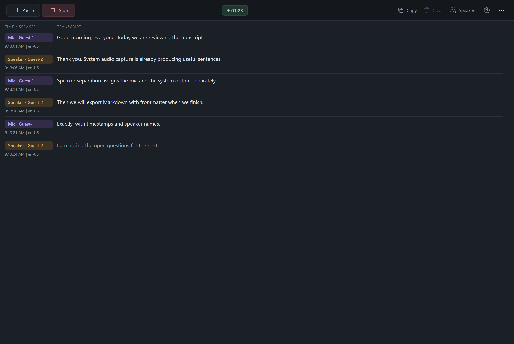
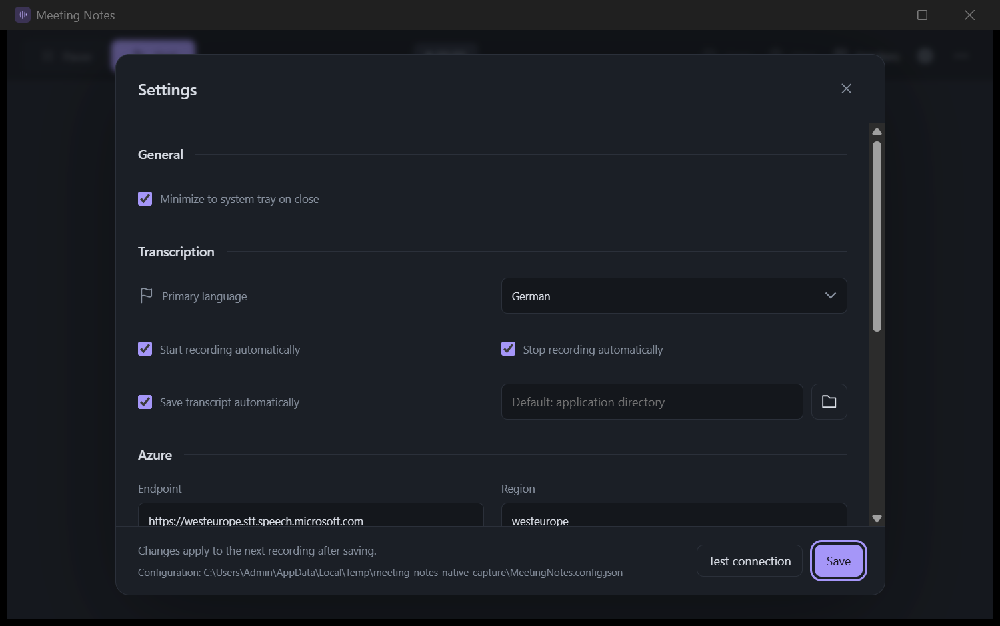
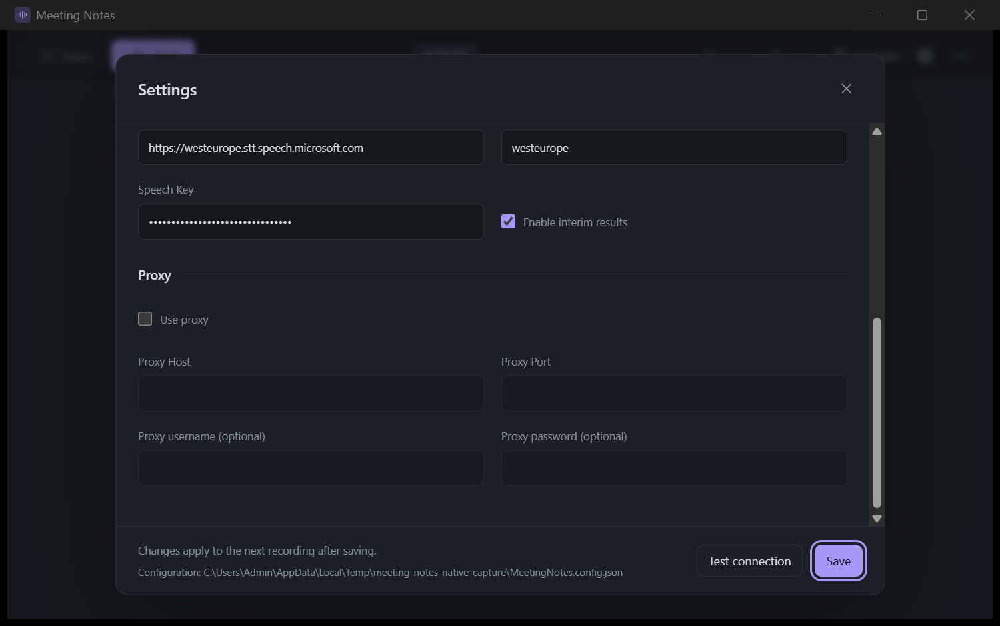
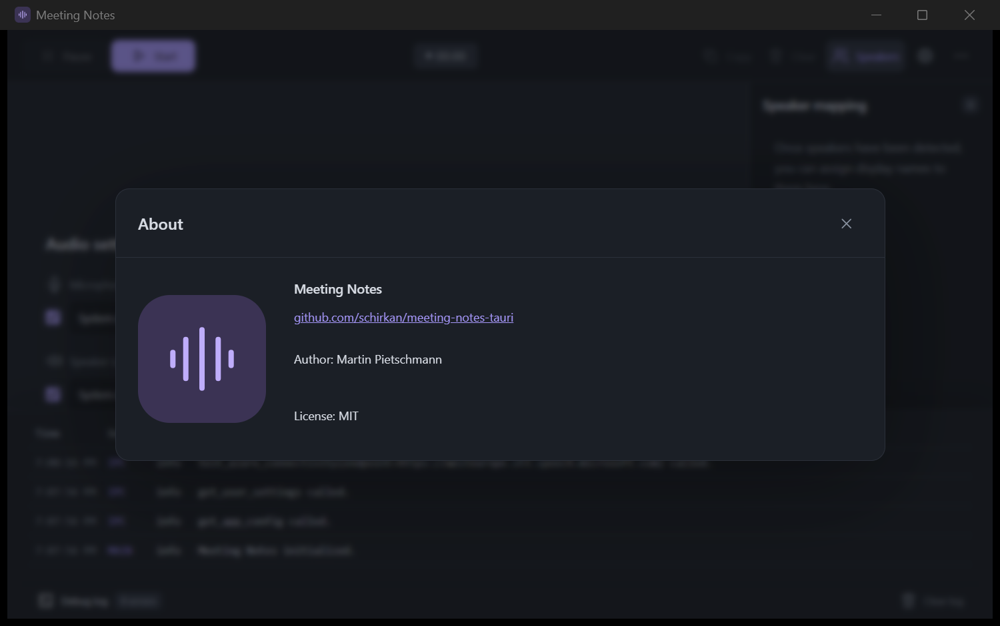
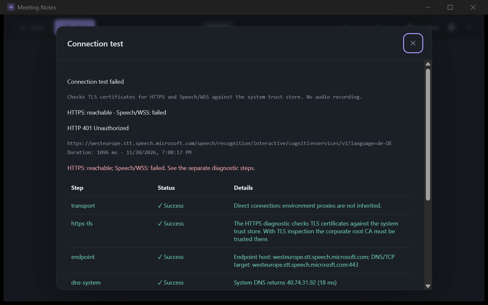

# 🎙️ Meeting Notes

**Meeting transcripts for Windows — transcribe live or record locally for later, and export readable Markdown notes.**

Meeting Notes can capture your microphone and system audio together or separately.
Azure Speech is the default live model; experimental Windows speech models are
also available on `main`.

[⬇️ Download](https://github.com/schirkan/meeting-notes-tauri/releases) ·
[🐛 Report an issue](https://github.com/schirkan/meeting-notes-tauri/issues) ·
[📄 License](./LICENSE)

This README describes the development branch. Local WAV recording, file transcription, experimental Windows speech models, and the redesigned home page are not in the latest published release, **v0.1.9**. For that version, see the [v0.1.9 README](https://github.com/schirkan/meeting-notes-tauri/blob/v0.1.9/README.md).

## ✨ Features

- **Live transcripts:** See finalized results as recognition completes, with optional interim text.
- **Independent audio sources:** Choose a microphone, speaker playback (loopback), or both.
- **Speaker mapping:** With models that support speaker recognition, enable it for all active sources and replace speaker labels with names.
- **Pause and resume:** Supported live models can pause and continue within the same session.
- **Markdown export:** Save or copy finalized transcripts with timestamps, speakers, and session metadata.
- **Portable app:** Extract the complete folder and run it without an installer. The .NET runtime ships with the app.
- **Connection diagnostics:** Test Azure connectivity and an optional corporate proxy from the settings dialog.
- **Application information and diagnostics:** **About** in the three-dot menu shows the app icon, repository, author and MIT license. **Dev-Tools (F12)** toggles developer tools, as does F12. Webpage right-click menus are suppressed except in text fields and editable content; native window and tray menus are unaffected.
- **System tray:** The tray icon turns **red while transcribing**, **yellow while paused**, and returns to its original color after stopping or a sidecar crash. Right-click it for **Show** or **Quit**. **Show** and a left double-click restore and focus the main window. **Hide from taskbar** under **General** is on by default and takes effect after saving. If the system tray cannot be initialized, the window stays on the taskbar. With **Minimize to system tray on close** enabled, closing the window keeps the app, transcription, and meeting detection running. With it disabled, closing the window quits the app even when **Hide from taskbar** is on. Closing to quit or choosing **Quit** from the tray asks for confirmation while transcription is running or paused. **Cancel** leaves the session open. Confirming **Quit** stops transcription, collects the final segments, and saves them as Markdown in the configured folder before exiting, even if **Save transcript automatically** is off. No file is written if there are no final segments. If stopping or saving fails, the app stays open. After a stop failure, choose **Quit** again to save the final text collected so far; results not received from Azure cannot be recovered. You can also export manually, and write failures are shown in the app.
- **Automatic start and stop:** The **Transcription** settings can start the selected workflow when an allowed meeting app's Windows audio sessions become active and stop it after 3 seconds of inactivity. Both options default to on. Auto-stop only applies to the session auto-started for that meeting. Web Speech is manual only. This is an audio-session heuristic, not a definitive meeting signal.

### Record now, transcribe later

For Azure file transcription, set **Settings → Azure → File transcription endpoint** to your Speech resource origin, such as `https://<resource>.cognitiveservices.azure.com`. If this field is blank and your existing live endpoint is already a suitable resource endpoint, it is reused. A regional `*.stt.speech.microsoft.com` endpoint does not work for file transcription. Both modes use the configured Speech key. For SAPI, select the language spoken in the file. If no text is recognized, listen to the selected WAV and check **Debug log** for the reported input level and rejected recognitions.

Choose **Record for later** under **Record a meeting** to record locally, even without speech credentials or a ready model. **Start recording** and meeting auto-start share this local recording path. **Stop recording** or meeting auto-stop saves audio and fills in **Transcribe audio files**; it does not transcribe or upload it.

Meeting Notes saves separate microphone and loopback WAVs in the Markdown export folder (next to the app by default), even if automatic Markdown export is off. Tracks are 16 kHz, 16-bit mono WAV, about 115 MB per track per hour. Both tracks begin at the recording start, including leading silence, and share a UTC timestamp and a unique ID in their filenames. No separate metadata file is written. Under **Transcribe audio files**, select one or two PCM WAVs, verify their local start times, and choose a model. Model, language and speaker preferences are saved separately from the recording preferences. Azure Standard, Azure MAI and Windows SAPI can merge timed segments from two tracks. Web Speech remains live-only. The **×** clears the selection without deleting the WAV. Azure asks for confirmation before uploading and requires an HTTPS Speech resource endpoint for both models. Azure Fast Transcription currently accepts files smaller than 250 MB and shorter than two hours; split longer files before importing. After stopping, use **Home** and **Transcript** in the top bar to switch views. Starting another recording clears the displayed transcript; exported files remain on disk.

## Screenshots

These **v0.1.4** screenshots are historical. They do not show the current home page or model controls. They show the native app except for the live transcript, which uses mocked data in the headless renderer. See the [screenshot guide](./docs/README.md) for details.

### Main window


### Live transcript



### Settings

The settings dialog is a single scrolling page. The captures show its v0.1.4 layout.

| Settings (top) | Settings (bottom) |
|---|---|
|  |  |

### About



### Connection diagnostics



### Speaker mapping


### Debug log

Use **Copy log** next to **Clear log** to copy the current entries as tab-separated text.


## 📦 Installation

### Requirements

- Windows 11, 64-bit (x64)
- [Microsoft Edge WebView2 Runtime](https://developer.microsoft.com/en-us/microsoft-edge/webview2/) — already installed on many Windows 11 systems
- For Azure: an internet connection and an **Azure Speech resource** with a region and key. Standard live transcription and Azure file transcription also need a suitable endpoint.
- For live capture or local recording: a microphone and/or an audio output device. Importing a WAV does not require either.

### Run the portable version

1. Download the portable ZIP from [Releases](https://github.com/schirkan/meeting-notes-tauri/releases). Every tagged version is published there as `MeetingNotes-v<version>-win-x64.zip`, together with a `SHA256SUMS.txt` for verification (`sha256sum -c SHA256SUMS.txt`).
2. Extract **all files** into a folder you can write to.
3. Run `MeetingNotes.exe`. Keep `MeetingNotes.Sidecar.exe` in the same folder.
4. If you use Azure, configure your connection as described below.

Releases are built by a GitHub Actions workflow from the tagged commit, so the published
ZIP always matches the tag. See [Development and building from source](#development-and-building-from-source).

The app is not code-signed, so Windows may display a security warning.
Only use downloads from a trusted source.

## 🚀 Getting started

The instructions below refer to the labels shown in the app.

### Connect to Azure

Azure Speech: [Documentation](https://learn.microsoft.com/en-us/azure/ai-services/speech-service/) · [Product information](https://azure.microsoft.com/en-us/products/ai-foundry/tools/speech).

The app starts on the home page even if Azure is not configured. If the selected live Azure model requires missing configuration, a warning appears and **Configure Azure** opens Settings on demand.

1. Select the live **Transcription model** on the start page. Under **Azure** in Settings, enter your region and Speech Key. **Azure Speech (standard)** also requires your Azure Speech endpoint.
2. To use an HTTP proxy, enter its hostname or IP address and port under **Proxy**. Do not include `http://` or a path. Leave **Proxy Host** blank for a direct connection.
3. Use **Test connection** to check connectivity. This test does not capture microphone or system audio, but it does connect to Azure.
4. Click **Save**. Successful saving closes the dialog; errors leave it open with an explanation.

The dialog initially focuses **Save**. All footer actions have the same
height. Edits, including export-folder selection, remain in a temporary draft
until **Save** is clicked. Closing with **x**, Escape or the backdrop asks
to discard unsaved changes; cancelling keeps the draft. Connection tests use
the draft without saving it and return to it when the test dialog closes.

**Azure MAI Transcribe (Preview)** uses the existing Azure Speech SDK and requires a Speech resource and key in a [supported region](https://learn.microsoft.com/en-us/azure/ai-services/speech-service/mai-transcribe-2-streaming-speech-sdk). The Azure model is in public preview without an SLA. In Meeting Notes, MAI detects the language automatically, supports mono only, and uses source-based labels instead of speaker recognition.

Under **Record a meeting → Transcribe live → Audio stream mode**, **Mono (separate sessions per audio device)** is the default. **Stereo (one session)**, available only with Azure Speech Standard, sends both sources on separate channels in one Speech SDK session. With one source enabled, audio stays mono. Standard stereo uses the primary language; Standard mono can also use automatic language detection. **Enable interim results** is available in both modes. Stereo interim text appears without a source label when the channel cannot be verified. One session does not establish billing savings.

**Test connection** uses the saved live model and its options, plus the current Azure and proxy draft. It sends silence in stereo when Standard, both sources, and **Stereo (one session)** are selected. Stop recording before testing. Meetings detected during the test do not trigger a delayed auto-start; start manually afterward if the meeting is still in progress. A successful test verifies connection readiness, not channel routing, file uploads, or recognition quality.

**Experimental models without Azure credentials:** Select **Windows SAPI (Experimental)** or **Web Speech API (Experimental)** under **Record a meeting → Transcription model**. Controls the selected model cannot use are disabled. Windows SAPI uses an installed Windows desktop dictation engine for the selected language and maintains separate microphone and loopback streams. Web Speech API uses the default microphone and starts only manually; it does not support loopback, device selection, auto-start or pause. WebView2 may send microphone audio to an online speech service. It can fail if the browser API is unavailable, microphone access is denied, the network is unavailable, or organizational policy blocks recognition. No model falls back to Azure. **Check model availability** does not record audio; it is not a live recognition test.

**Upgrading from v0.1.8:** From v0.1.9, `user.diarization` is saved as a single boolean. If speaker recognition was enabled for either source, it is enabled for all active sources after the upgrade. Back up `MeetingNotes.config.json` before upgrading. Rollback is not supported; v0.1.8 and earlier can use default user settings if given a configuration saved by v0.1.9.

For MAI, **Test connection** checks the regional Speech/WSS connection, not the Standard HTTPS endpoint or transcription quality. The model change is saved immediately on the home page and takes effect on the next recording. To switch back, select **Azure Speech (standard)**. The Standard endpoint, primary language, and stereo preference are retained; check that the region and key match the Standard resource before starting.

### Transcribe a conversation

1. Under **Record a meeting**, select the audio devices, then choose **Transcribe live** and configure the model and language, or choose **Record for later** for local WAV capture. Changes save immediately. In Settings, **General** contains window preferences and **Transcription** contains automatic start/stop and export. **Test connection** is in the footer for the saved live model when the required Azure fields are filled in. **Save transcript automatically** enables automatic Markdown export; the adjacent path and folder icon select its destination.
2. Use the checkboxes next to the device selectors to enable microphone audio, speaker playback, or both. At least one source stays enabled.
3. Enable **Speaker recognition** under **Transcription model** if needed. In live mode this applies to all active sources with the Standard model.
4. Click **Start**. The live transcript appears in the main area.
5. **Pause** pauses transcription, **Resume** continues the session, and **Stop** ends it.

Starting again creates a **new transcript and session**. Speaker mappings from
the previous session are not carried over. Edit speaker names directly in the
transcript, or click **Speakers** to open the mapping overview.

### Save your notes

- **Copy** copies the finalized transcript to the clipboard as Markdown.
- **Export Markdown** in the three-dot menu saves it to a file.
- Automatic export when transcription ends is enabled by default. Disable it or change the output folder under **Transcription**, then click **Save**.
- Use **Choose folder** to choose an export folder with the native folder picker, or enter a path manually.

With no custom path, exports are saved next to the EXE. Relative paths are
resolved from that folder too. File export and clipboard copying use the same
Markdown format with YAML frontmatter.

## 🔐 Privacy and costs

**Where audio is processed depends on the mode.** Azure live transcription sends
enabled sources to Azure Speech; Azure file transcription uploads the selected
WAVs only after confirmation. Azure usage may incur charges. **Record for later**
stores WAVs locally, and Windows SAPI processes audio locally. Web Speech API may
send microphone audio to an online service. Obtain participants' agreement before
recording or sharing conversation content.

Settings are stored in `MeetingNotes.config.json` next to the EXE. This file
contains the Azure key and any proxy credentials **in plain text**. Do not
commit it to a public repository or include it in a portable folder you share.
Review transcripts and diagnostic output for confidential information before
sharing them as well.

With auto-start enabled, the detector watches microphone/output session
metadata for allowed applications. That happens **locally** - no calendar is read and nothing leaves
the machine as part of detection. The mode that starts automatically determines
whether audio stays local or is sent to Azure.

## 🛠️ Troubleshooting

| Problem | What to check |
| --- | --- |
| Start is unavailable | Check the selected audio sources, any configuration or model error shown by the app, and whether settings have finished saving. Azure credentials are not needed for **Record for later**. |
| Microphone or system audio is missing | Make sure the source is enabled and the correct device is selected. Loopback captures playback from the selected output device; no playback means there may be no audio packets. |
| Connection fails on a corporate network | Check proxy settings and run **Test connection**. HTTP `407` indicates proxy authentication; `401`/`403` alone do not confirm a working Speech connection. |
| Certificate errors with TLS inspection | The corporate certificate must be trusted by Windows. Both HTTPS and Speech/WSS validate certificates. |
| The transcription service crashes | Export the existing transcript if needed, then click **Start** to begin a new session. Restarting the app is not required; automatic reconnection is not provided. |

Open **Debug log** from the three-dot menu for more details. Only error rows
and the error counter are highlighted in red.

The app is under development. Recognition quality, speaker mapping, and
latency depend on your audio hardware, network, and Azure. The current build
has not yet been fully validated in live use or on a freshly installed Windows
system. Try it in your own environment before relying on it for an important
meeting. macOS, Linux, and mobile devices are not supported.

## Development and building from source

The interface uses Tauri 2 and React/TypeScript. Audio capture and Azure Speech
run in a C# sidecar process.

In addition to Windows, you need:

- Git and Node.js **22.12 or newer, below 27**
- Rust stable with the Windows MSVC toolchain
- Visual Studio or Build Tools with **Desktop development with C++** and the Windows SDK
- .NET 10 SDK

```powershell
git clone https://github.com/schirkan/meeting-notes-tauri.git
Set-Location meeting-notes-tauri
npm ci
powershell -NoProfile -File scripts\check-toolchain.ps1
npm run tauri -- dev
```

During development, the personal configuration lives in the repository root.
See the [example configuration](./MeetingNotes.config.example.json) for the file format.

### Build a portable distribution

Close the running app and back up any personal configuration in `dist\portable`
first: the build replaces that output folder.

```powershell
npm run tauri -- build --no-bundle
npm run dist:portable
npm run test:smoke
```

Output is written to `dist\portable`. The sidecar is automatically published
as a self-contained, compressed, conservatively trimmed single-file EXE.
**Use the Tauri CLI for distribution builds**, not just `cargo build`: the CLI
ensures the frontend is embedded in the application.

```powershell
npm run verify
npm run test:sidecar:published
npm run verify:deployment
```

For the native tray callback/menu/exit probe, run `npm run test:tray` on an interactive Windows desktop with Explorer. It uses an isolated portable copy and no personal configuration. This is not a substitute for checking the visible icon, physical double-click and Alt+F4 yourself; headless execution reports SKIPPED. See [T-514](./specs/T-514-systray-und-schliessen-verhalten.md).

### Releases and CI

GitHub Actions builds and publishes the portable releases. There is **no automatic build on push** - the workflow only runs when a release tag is pushed:

- **Release** (`.github/workflows/release.yml`) runs when you push a `v*` tag. It checks out exactly that tag, runs typecheck and Node tests, builds the portable distribution, verifies it with the smoke test and the deployment check, and publishes the ZIP as a GitHub release asset together with a `SHA256SUMS.txt` file in `sha256sum` format.
- A missing release can be published later without moving the tag via **Run workflow** with the `tag` input.

```powershell
git tag v0.1.3
git push origin v0.1.3
```

The workflow skips C# sidecar validation, which needs real audio hardware. Run
the Rust tests and spec consistency check locally as well. Details in
[T-515](./specs/T-515-github-actions-pipeline-und-release.md).

For technical details and outstanding checks, see the [specification](./SPEC.md),
[architecture decisions](./DECISIONS.md), and [individual specs](./specs/).

## 🤝 Feedback and license

Bug reports and suggestions are welcome in
[GitHub Issues](https://github.com/schirkan/meeting-notes-tauri/issues).
Include your Windows version, audio source, and steps to reproduce the problem.
**Do not attach keys, passwords, or confidential transcripts.**

Created by **Martin Pietschmann**. Released under the [MIT License](./LICENSE).
